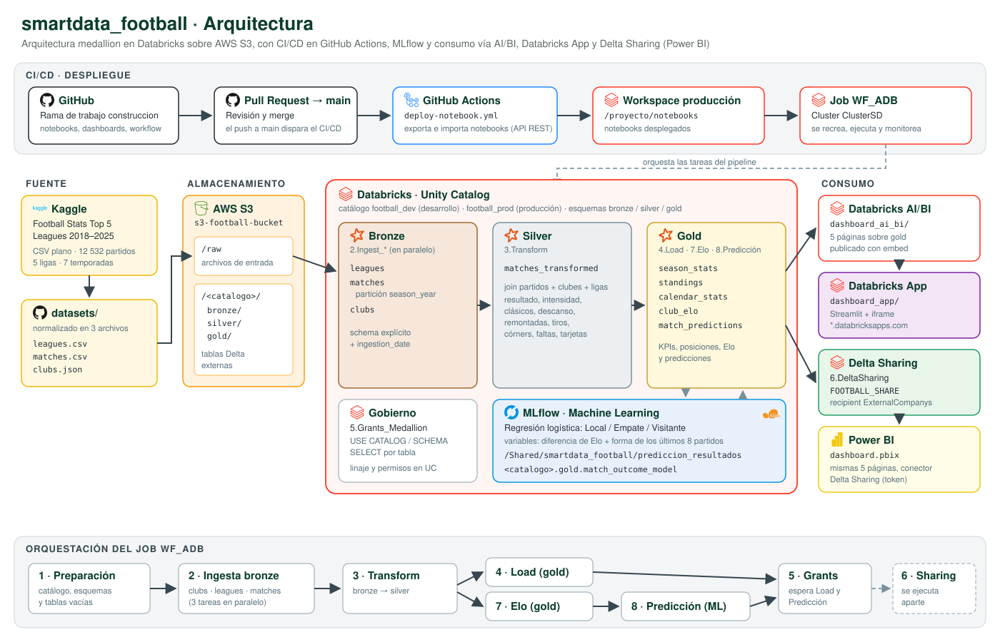

# ⚽ smartdata_football

**Trabajo final · Ingeniería de Datos e IA con Databricks**

Pipeline de ingeniería de datos y machine learning sobre los partidos de las cinco grandes ligas europeas (Premier League, La Liga, Serie A, Bundesliga y Ligue 1) entre las temporadas 2018/19 y 2024/25. El proyecto implementa una arquitectura medallion (bronze, silver y gold) en Databricks con Unity Catalog, almacena los datos en AWS S3, entrena un modelo de predicción de resultados con MLflow, despliega todo con CI/CD en GitHub Actions y publica los resultados en un dashboard de Databricks y en Power BI mediante Delta Sharing.

## Contenido

1. [Objetivos](#1-objetivos)
2. [Arquitectura](#2-arquitectura)
3. [Tecnologías](#3-tecnologías)
4. [Origen de los datos](#4-origen-de-los-datos)
5. [Estructura del repositorio](#5-estructura-del-repositorio)
6. [Pipeline de datos](#6-pipeline-de-datos)
7. [Modelo de datos](#7-modelo-de-datos)
8. [Machine learning](#8-machine-learning)
9. [Gobierno y seguridad](#9-gobierno-y-seguridad)
10. [CI/CD](#10-cicd)
11. [Consumo: dashboards](#11-consumo-dashboards)
12. [Cómo ejecutarlo](#12-cómo-ejecutarlo)
13. [Resultados](#13-resultados)

## 1. Objetivos

- Construir un pipeline reproducible que lleve los datos crudos de partidos hasta tablas analíticas listas para consumo.
- Aplicar la arquitectura medallion con tablas Delta gobernadas por Unity Catalog.
- Calcular indicadores de negocio: KPIs por liga y temporada, tablas de posiciones, estadísticas por mes y un rating Elo por club.
- Entrenar, registrar y versionar un modelo que estime la probabilidad de victoria local, empate o victoria visitante.
- Automatizar el despliegue a producción con CI/CD y compartir los resultados con consumidores externos.

## 2. Arquitectura



<sub>Íconos de [Simple Icons](https://simpleicons.org) (CC0). Las marcas pertenecen a sus respectivos dueños.</sub>

El flujo tiene cinco bloques:

| Bloque | Qué hace |
|---|---|
| **Fuente** | El dataset de Kaggle (un CSV plano) se normalizó en tres archivos: `leagues.csv`, `matches.csv` y `clubs.json`. |
| **Almacenamiento** | Los archivos se suben a la carpeta `raw/` del bucket S3. Las tablas Delta de cada capa se guardan como tablas externas en `s3://<bucket>/<catalogo>/<capa>/<tabla>`. |
| **Procesamiento** | Databricks ingesta los archivos en **bronze**, los limpia y enriquece en **silver** y genera las tablas analíticas de **gold**, incluido el rating Elo y las predicciones del modelo. |
| **Machine learning** | MLflow registra el experimento (parámetros, métricas por temporada) y el modelo en Unity Catalog. |
| **Consumo** | Un dashboard AI/BI de Databricks lee gold; una Databricks App (Streamlit) lo muestra por iframe; Power BI lee las mismas tablas vía Delta Sharing. |

El job `WF_ADB` orquesta las tareas en producción, y GitHub Actions lo recrea y ejecuta cada vez que se hace merge a `main`.

## 3. Tecnologías

| Componente | Uso en el proyecto |
|---|---|
| Databricks (PySpark, Spark SQL) | Procesamiento de las capas bronze, silver y gold |
| Delta Lake | Formato de todas las tablas (particionado, overwrite, `REORG`) |
| Unity Catalog | Catálogos, esquemas, tablas externas, permisos y registro de modelos |
| AWS S3 | Almacenamiento de archivos crudos y de las tablas Delta |
| Databricks Workflows | Job `WF_ADB` con dependencias entre tareas |
| MLflow + scikit-learn | Entrenamiento, validación, seguimiento y registro del modelo |
| Delta Sharing | Publicación de las tablas gold para consumidores externos |
| Databricks AI/BI | Dashboard dentro del workspace |
| Databricks Apps | App Streamlit que incrusta el AI/BI publicado |
| Power BI | Dashboard externo conectado por Delta Sharing |
| GitHub Actions | CI/CD de notebooks y del job |

## 4. Origen de los datos

Los datos salen de [Football Stats - Top 5 Leagues European 2018–2025](https://www.kaggle.com/datasets/clemendes/football-stats-top-5-leagues-2018-to-2025) (`stats_top5_leagues._2018_2025.csv`): **12 532 partidos, 144 clubes, 5 ligas y 7 temporadas**.

El CSV original es plano (una fila por partido con `Div`, `Date`, `HomeTeam`, `AwayTeam`, `FTHG`, `FTAG`, `Season`, etc.). Para modelar un caso más realista se normalizó en tres archivos, que están en `datasets/`:

| Archivo | Formato | Contenido |
|---|---|---|
| `leagues.csv` | CSV con encabezado | 5 ligas: `league_id`, `league_ref`, `name`, `country`, `country_code`, `confederation`, `tier`, `founded_year`. |
| `matches.csv` | CSV con encabezado | 12 532 partidos: `match_id`, `season_year`, `round`, `match_date`, `league_id`, `home_club`, `away_club`, goles finales y al descanso, y estadísticas por equipo (`home_`/`away_`): `shots`, `shots_on_target`, `corners`, `fouls`, `yellow_cards`, `red_cards`. |
| `clubs.json` | Arreglo JSON | 144 clubes: `club_id`, `club_ref`, `name`, `country`, `city`, `founded_year`, `league_id`. |

`round` es la jornada (1–38, o 1–34 en ligas de 18 clubes), asignada por orden cronológico dentro de cada liga y temporada.

## 5. Estructura del repositorio

```
smartdata_football/
├── .github/workflows/
│   └── deploy-notebook.yml        # CI/CD: despliega notebooks y recrea el job WF_ADB
├── datasets/                      # Archivos de entrada (capa raw)
│   ├── leagues.csv
│   ├── matches.csv
│   └── clubs.json
├── proceso/                       # Pipeline principal (lo que despliega el CI/CD)
│   ├── 1.Preparacion_Ambiente.ipynb
│   ├── 2.Ingest_clubs.ipynb
│   ├── 2.Ingest_leagues_data.ipynb
│   ├── 2.Ingest_matches_data.ipynb
│   ├── 3.Transform.ipynb
│   ├── 4.Load.ipynb
│   ├── 5.Grants_Medallion.ipynb
│   ├── 7.Elo_Ranking.ipynb
│   └── 8.Prediccion_Resultados.ipynb
├── machine-learning/              # Notebooks de Elo y del modelo predictivo
│   ├── 7.Elo_Ranking.ipynb
│   └── 8.Prediccion_Resultados.ipynb
├── delta-sharing/
│   └── 6.DeltaSharing.ipynb       # Publica las tablas gold en el share (fuera del job)
├── seguridad/
│   └── 5.Grants_Medallion.ipynb   # Permisos (GRANT) para los usuarios
├── PrepAmb/                       # Preparación del ambiente para correrla de forma aislada
├── reversion/                     # Teardown: revoca permisos, borra tablas, archivos y catálogo
├── dashboard/
│   ├── dashboard_ai_bi/
│   │   └── dashboard.lvdash.json  # Dashboard AI/BI de Databricks
│   ├── dashboard_app/             # Databricks App (Streamlit + iframe del AI/BI)
│   │   ├── app.py
│   │   ├── app.yaml
│   │   ├── requirements.txt
│   │   └── README.md
│   └── powerbi/
│       ├── dashboard.pbix         # Dashboard de Power BI
│       ├── dashboard.pbit         # Plantilla de Power BI (sin datos)
│       └── README.md
├── evidencias/                    # Capturas del proceso de construcción y despliegue
├── certificaciones/               # Acreditación Databricks Fundamentals
└── docs/
    └── arquitectura.svg           # Diagrama de arquitectura
```

## 6. Pipeline de datos

### Notebooks

| Notebook | Capa | Qué hace |
|---|---|---|
| `1.Preparacion_Ambiente` | Infraestructura | Borra y recrea el catálogo, los esquemas `raw`, `bronze`, `silver` y `gold`, y las tablas Delta externas vacías en S3. |
| `2.Ingest_leagues_data` | Bronze | Lee `leagues.csv` con schema explícito y escribe `bronze.leagues` con `ingestion_date`. |
| `2.Ingest_matches_data` | Bronze | Lee `matches.csv` y escribe `bronze.matches` particionada por `season_year`. |
| `2.Ingest_clubs` | Bronze | Lee `clubs.json` (multilínea) y escribe `bronze.clubs`. |
| `3.Transform` | Silver | Cruza partidos, clubes (local y visitante) y ligas, limpia nulos y crea los atributos de negocio. Escribe `silver.matches_transformed`. |
| `4.Load` | Gold | Escribe `gold.season_stats`, `gold.standings` y `gold.calendar_stats`. |
| `7.Elo_Ranking` | Gold | Calcula el Elo de cada club partido a partido y escribe `gold.club_elo`. |
| `8.Prediccion_Resultados` | Gold / ML | Entrena y registra el modelo en MLflow y escribe `gold.match_predictions`. |
| `5.Grants_Medallion` | Gobierno | Otorga permisos de Unity Catalog sobre catálogo, esquemas y tablas. |
| `6.DeltaSharing` | Consumo | Publica las 5 tablas gold en el share `FOOTBALL_SHARE` para el recipient de Power BI. |

Todos los notebooks reciben parámetros por widgets (`catalogo`, `storageName`, `container`, `esquema`, `esquema_source`, `esquema_sink`), así que el mismo código corre en desarrollo (`football_dev`) y en producción (`football_prod`).

### Job `WF_ADB`

```
preparacion_ambiente
   ├── ingest_clubs ─────────┐
   ├── ingest_leagues_data ──┼── transform ──┬── Load ───────────────────┐
   └── ingest_matches_data ──┘               └── elo ── prediccion ──────┴── grants
```

- Las tres ingestas corren en paralelo.
- `Load` y `elo` corren en paralelo después de `transform`; `prediccion` espera a `elo`.
- `grants` espera a `Load` y a `prediccion`.
- Cada tarea tiene 2 reintentos y un tope de 1 hora. El job tiene una programación diaria a las 8:00 (America/Lima), en pausa por defecto.
- `6.DeltaSharing` no forma parte del job: se ejecuta después, cuando las tablas gold ya están cargadas.

## 7. Modelo de datos

Catálogo `football_dev` (desarrollo) o `football_prod` (producción), con los esquemas `bronze`, `silver` y `gold`.

### Bronze

| Tabla | Descripción |
|---|---|
| `bronze.leagues` | Ligas tal como vienen del CSV, con `ingestion_date`. |
| `bronze.matches` | Partidos con goles y estadísticas por equipo, particionada por `season_year`. |
| `bronze.clubs` | Clubes del JSON. |

### Silver: `silver.matches_transformed`

Un registro por partido con el nombre de la liga y los datos de ambos clubes. Reglas de negocio:

| Columna | Regla |
|---|---|
| `result_type` | `Local`, `Empate` o `Visitante` |
| `goal_diff_category` | `Ajustado` (0–1 goles de diferencia), `Normal` (2), `Goleada` (3+) |
| `match_intensity` | `Baja` (≤ 2 goles), `Media` (3–4), `Alta` (5+) |
| `is_classic` | `Clasico` para los clásicos (Real Madrid–Barcelona, United–Liverpool, Milan–Inter, Bayern–Dortmund, PSG–Marsella, etc.) o `Regular` |
| `season_age` | Años desde la temporada |
| `ht_result` | Resultado al descanso |
| `is_comeback` | `true` si el equipo que perdía al descanso ganó el partido |
| `second_half_goals` | Goles del segundo tiempo |
| `total_shots`, `total_shots_on_target`, `total_corners`, `total_fouls`, `total_cards` | Totales del partido |

### Gold

| Tabla | Granularidad | Contenido |
|---|---|---|
| `gold.season_stats` | Temporada × liga | Partidos, goles (total, máximo, mínimo), clásicos, victorias locales y visitantes, empates, remontadas, goles del segundo tiempo, tiros, tiros a puerta, córners, faltas y tarjetas. |
| `gold.standings` | Temporada × liga × club | Tabla de posiciones: PJ, G, E, P, GF, GC, DG, puntos, puntos de local y visitante, forma de los últimos 5 partidos (`last5_form`) y `zone` (`Campeon`, `Champions League`, `Media tabla`, `Descenso`). Desempate por puntos, diferencia de goles, goles a favor y nombre. |
| `gold.calendar_stats` | Temporada × liga × jornada × mes | Partidos, goles, resultados, remontadas y tarjetas; `month_name` en español y `season_month_order` de agosto (1) a julio (12). |
| `gold.club_elo` | Partido × club | Elo antes y después del partido (`elo_pre`, `elo_post`, `elo_change`), Elo del rival, goles y resultado (`W`/`D`/`L`). |
| `gold.match_predictions` | Partido | Probabilidades `prob_home`, `prob_draw`, `prob_away`, la predicción, el resultado real, `is_correct` y `split` (`entrenamiento` / `prueba`). |

**Rating Elo** (`7.Elo_Ranking`): cada liga se calcula por separado; todos los clubes arrancan en 1500 y los ascendidos en 1450; K = 20, ventaja de local de 60 puntos y un multiplicador por diferencia de goles. Al empezar cada temporada el rating se acerca un 10 % a 1500.

## 8. Machine learning

El notebook `8.Prediccion_Resultados` estima, antes de cada partido, la probabilidad de victoria local, empate o victoria visitante.

| Aspecto | Detalle |
|---|---|
| Modelo | `StandardScaler` + `LogisticRegression` multiclase (`C = 0.01`) |
| Variables | Diferencia de Elo antes del partido y forma de los últimos 8 partidos de cada club en la temporada: puntos, diferencia de goles y diferencia de tiros a puerta por partido |
| Validación | Validación temporal: para cada una de las 4 temporadas previas a la última se entrena con las anteriores y se evalúa en esa temporada |
| Prueba | El modelo final se entrena con todas las temporadas menos la última (2024/25), que queda como prueba |
| Métricas | Log loss y accuracy por temporada de validación, accuracy, F1 macro y log loss de prueba, y la línea base "siempre gana el local" |
| Seguimiento | Experimento MLflow `/Shared/smartdata_football/prediccion_resultados` |
| Registro | Modelo `<catalogo>.gold.match_outcome_model` en Unity Catalog, con firma y ejemplo de entrada |

La ventana de 8 partidos, `C = 0.01` y la regresión del Elo al 10 % se eligieron por log loss de validación. También se probaron variables de contexto (forma como local o visitante, días de descanso, recién ascendido, fase de la temporada y enfrentamientos directos), pero no mejoraron la validación.

## 9. Gobierno y seguridad

- **Unity Catalog** gobierna catálogo, esquemas, tablas externas y el modelo registrado.
- **`5.Grants_Medallion`** otorga `USE CATALOG`, `USE SCHEMA` y `SELECT` sobre las tablas de las tres capas. En el job, sus celdas están marcadas con `%skip`; la versión completa, con los usuarios como parámetro, está en `seguridad/`.
- **Delta Sharing** (`delta-sharing/6.DeltaSharing`) comparte solo las 5 tablas gold, sin historial, con el recipient `ExternalCompanys`. Como `1.Preparacion_Ambiente` recrea el catálogo, el notebook vuelve a agregar las tablas al share en cada ejecución. También desactiva los deletion vectors y reescribe los archivos (`REORG ... APPLY (PURGE)`), porque Power BI no lee tablas con esa característica.
- **Secretos**: los tokens de Databricks viven en GitHub Secrets y el token de Delta Sharing no se guarda en el repositorio.
- **Reversión**: `reversion/1. Drop-Medallion` revoca los permisos otorgados y elimina las tablas, sus archivos en S3 y el catálogo.

## 10. CI/CD

Flujo de ramas: el trabajo se hace en `construccion` y llega a `main` por pull request.

Cada push a `main` ejecuta `.github/workflows/deploy-notebook.yml`:

1. Exporta los notebooks de `proceso/` desde el workspace de origen.
2. Los importa en el workspace de producción, en `/proyecto/notebooks`.
3. Borra el job `WF_ADB` si existe y lo vuelve a crear sobre el cluster `ClusterSD`, con los parámetros de producción (`football_prod`, `s3-football-bucket`).
4. Ejecuta el job y monitorea cada tarea hasta que termina.

Secrets requeridos: `DATABRICKS_ORIGIN_HOST`, `DATABRICKS_ORIGIN_TOKEN`, `DATABRICKS_DEST_HOST` y `DATABRICKS_DEST_TOKEN`.

## 11. Consumo: dashboards

Ambos dashboards tienen las mismas cinco páginas:

| Página | Contenido |
|---|---|
| Resumen | Partidos, goles por partido, % de victorias locales, precisión de tiro, evolución por temporada, resultados por liga y goles por mes |
| Ligas | Ranking y evolución por temporada de la métrica elegida (goles por partido, % victorias locales, precisión de tiro, conversión, tarjetas, remontadas) |
| Posiciones | Tabla de posiciones por liga y temporada, y Elo por club |
| Predicciones | Acierto del modelo frente a "siempre local", acierto por liga y detalle de predicciones |
| Club | Ficha del club: Elo final, cambio de Elo en la temporada, títulos, % de victorias, evolución del Elo e historial de partidos |

- **Databricks AI/BI** (`dashboard/dashboard_ai_bi/dashboard.lvdash.json`): se importa en el workspace y consulta `football_prod.gold`.
- **Databricks App** (`dashboard/dashboard_app/`): app Streamlit que incrusta el dashboard AI/BI publicado (iframe). Se despliega desde **Compute → Apps** apuntando a esta carpeta; el workspace debe permitir el dominio `*.databricksapps.com` en Embed dashboards.
- **Power BI** (`dashboard/powerbi/dashboard.pbix`): se conecta al share con el conector Delta Sharing. Para actualizarlo hace falta un archivo `config.share` vigente del recipient; su token se ingresa como credencial en Power BI Desktop.

## 12. Cómo ejecutarlo

1. Sube `datasets/leagues.csv`, `matches.csv` y `clubs.json` a `s3://<bucket>/raw/`.
2. Configura en Unity Catalog la credencial y la external location que dan acceso al bucket.
3. Importa la carpeta `proceso/` en el workspace de Databricks.
4. Ejecuta `1.Preparacion_Ambiente` y luego el resto en el orden del job, o deja que el CI/CD cree y ejecute `WF_ADB`.
5. Ejecuta `delta-sharing/6.DeltaSharing` para publicar las tablas gold.
6. Importa `dashboard/dashboard_ai_bi/dashboard.lvdash.json` en Databricks y abre `dashboard/powerbi/dashboard.pbix` en Power BI Desktop.
7. (Opcional) Despliega la Databricks App desde `dashboard/dashboard_app/` (ver `dashboard/dashboard_app/README.md`).

Consultas de ejemplo:

```sql
-- KPIs por temporada y liga
SELECT season_year, league_name, conteo, total_goals / conteo AS goles_por_partido
FROM football_prod.gold.season_stats
ORDER BY season_year DESC, league_name;

-- Campeones por temporada
SELECT season_year, league_name, club, points, last5_form
FROM football_prod.gold.standings
WHERE zone = 'Campeon'
ORDER BY season_year DESC, league_name;

-- Acierto del modelo en entrenamiento y prueba
SELECT split, AVG(is_correct) AS accuracy, COUNT(*) AS partidos
FROM football_prod.gold.match_predictions
GROUP BY split;
```

## 13. Resultados

- El pipeline procesa los 12 532 partidos en 5 tablas gold: 682 filas de tablas de posiciones y dos filas de Elo por partido.
- El modelo acierta el **53,5 %** de los partidos de la temporada de prueba 2024/25 (log loss 0,984), frente al **42 %** de apostar siempre por el local. Como la mayoría de modelos de este tipo, rara vez predice empate.
- Los resultados se publican de forma gobernada a un consumidor externo (Power BI) sin copiar datos, gracias a Delta Sharing.

---

**Autor:** César Valencia · [CesarValenciaM](https://github.com/CesarValenciaM)
